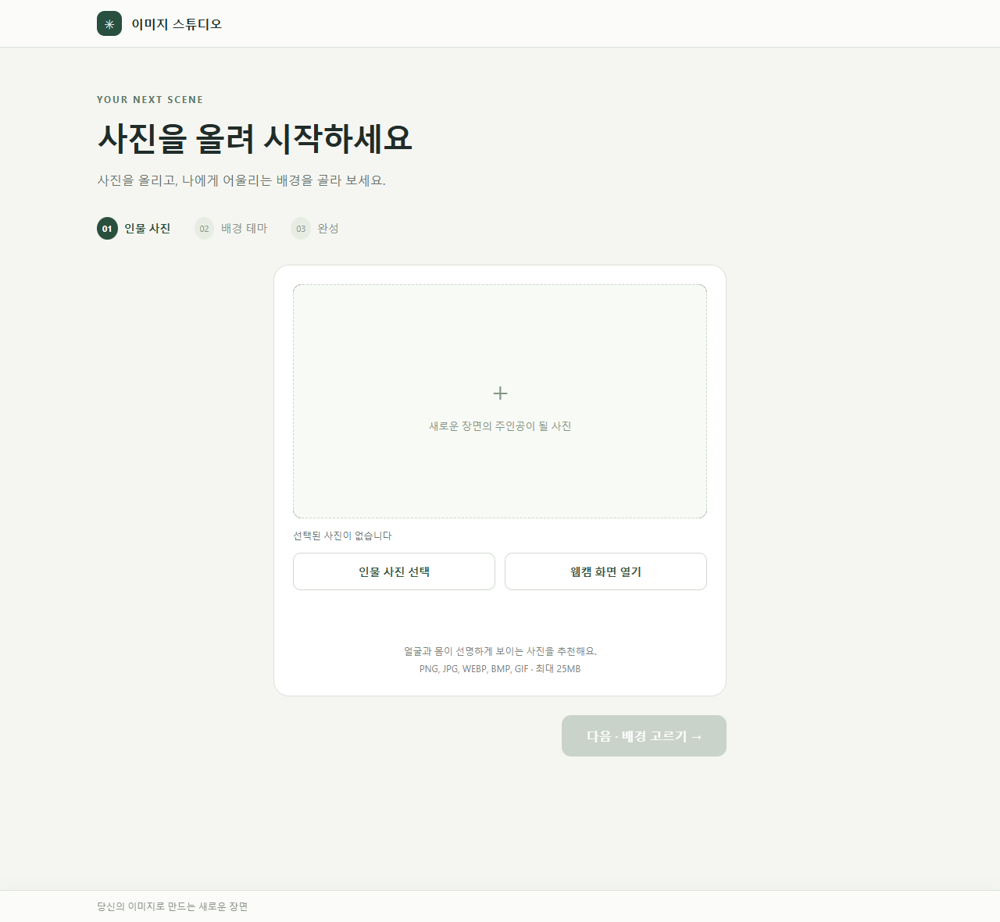
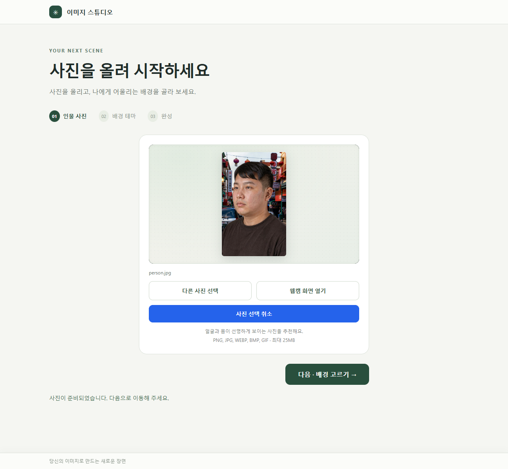
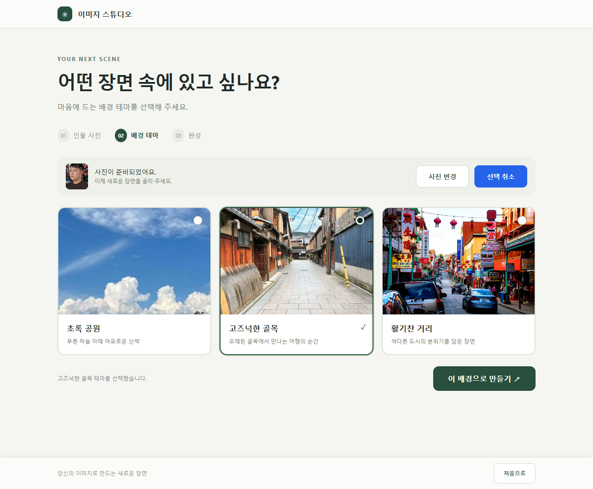
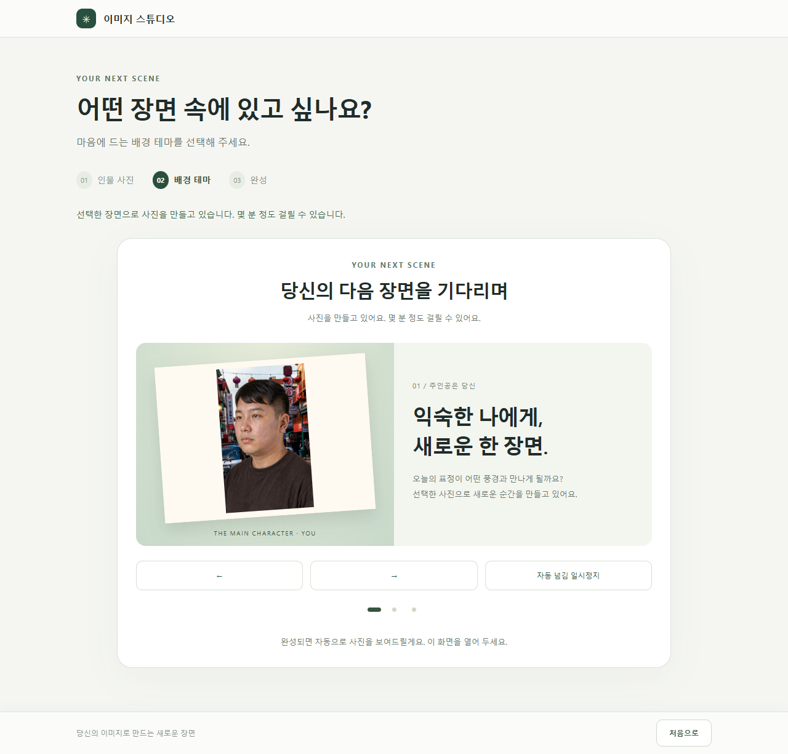
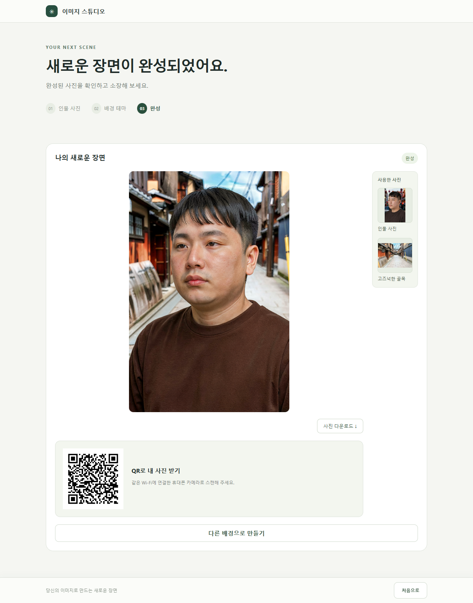
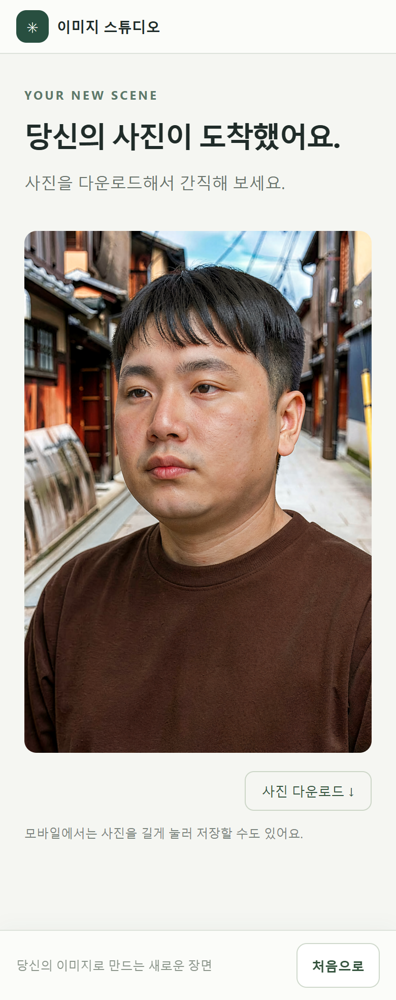
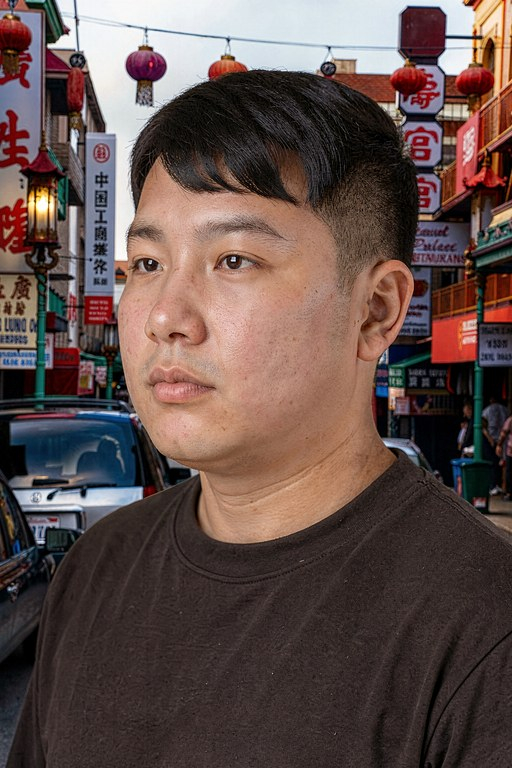

# ImgPls · 이미지 스튜디오

https://github.com/naluteo89-sketch/ImgPls.git

인물 사진 한 장과 배경 테마를 고르면, ComfyUI(FLUX.2 워크플로)로 **인물을 새 배경 속에 자연스럽게 합성한 사진**을 만들어 주는 웹 서비스입니다.
완성된 사진은 화면에서 바로 내려받거나, QR 코드를 찍어 같은 Wi‑Fi의 휴대폰으로 받을 수 있습니다.

---

## 1. 코드로 확인한 의도

| 구분 | 의도 | 근거 코드 |
| --- | --- | --- |
| 대상 | 행사장·체험 부스처럼 **현장 PC 한 대에서 방문객 사진을 찍어 바로 합성**해 주는 키오스크형 서비스 | 웹캠 촬영 기능, QR 공유, "같은 Wi‑Fi" 안내 문구 (`static/js/app.js`) |
| 입력 | 인물 사진 1장(파일 업로드 또는 웹캠 캡처) + 미리 준비한 배경 테마 3종 중 1개 | `THEMES` (`test.py`), `components/person-step.html`, `components/theme-step.html` |
| 생성 | 무거운 이미지 생성은 별도 GPU 서버(ComfyUI)에 맡기고, 이 서버는 **요청 중계·결과 저장·공유**만 담당 | `generate()` (`test.py`) |
| 출력 | 세로 1024×1536 PNG, 매 요청마다 새 시드로 다른 결과 | `studio_config.json`, `noise_seed = secrets.randbits(48)` |
| 공유 | 결과마다 공유 페이지와 QR 코드를 만들어 휴대폰으로 전달 | `/share/{filename}`, `/share/{filename}/qr` |
| 안전 | 업로드는 확장자·25MB 제한, 결과 파일은 `results/` 밖 경로 접근 차단, 공유 페이지는 검색 노출 차단 | `save_upload()`, `result_path()`, `X-Robots-Tag` |
| 사용성 | 오류 내용을 내부 정보 없이 사용자용 한국어 문구로 안내, 대기 중에는 슬라이드로 기다림을 덜어 줌 | `generate_image()` 예외 처리, `components/status.html` |

## 2. 구성

```
test.py                 FastAPI 서버 (화면 제공 + ComfyUI 연동 + 결과/공유)
composition.json        ComfyUI 워크플로 (FLUX.2 기반 인물·배경 합성)
studio_config.json      출력 크기(1024×1536), 공유용 외부 주소 설정
index.html              메인 화면 (Jinja2 템플릿)
templates/              화면 구성 요소, 공유 페이지(share.html)
static/css, static/js   화면 스타일과 동작 (3단계 진행, 웹캠, 대기 슬라이드, 결과·QR)
B/                      배경 테마 이미지 3종 (초록 공원 / 고즈넉한 골목 / 활기찬 거리)
results/                생성된 결과 사진 저장 위치
docs/                   이 보고서의 캡처 화면과 결과 예시
```

## 3. 동작 흐름

1. **인물 사진**: 파일을 고르거나 웹캠으로 촬영합니다. 브라우저에서 형식과 25MB 제한을 먼저 확인합니다.
2. **배경 테마**: 3개 테마 중 하나를 고르고 `POST /generate`로 보냅니다. 기다리는 동안 슬라이드 화면을 보여 줍니다.
3. **서버 처리** (`generate()`)
   - 인물 사진과 배경 사진을 ComfyUI에 업로드합니다 (`/upload/image`).
   - 워크플로에 이미지, 출력 크기, 새 시드, (선택) 프롬프트를 넣어 실행합니다 (`/prompt`).
   - WebSocket(`/ws`)으로 완료 신호를 기다립니다. 기본 최대 600초입니다.
   - 히스토리(`/history`)에서 결과를 찾아 내려받고(`/view`), 1024×1536 PNG로 맞춰 `results/`에 저장합니다.
4. **완성**: 결과 사진, 다운로드 버튼, QR 코드, 사용한 원본 사진을 함께 보여 줍니다.

### API

| 메서드 | 경로 | 설명 |
| --- | --- | --- |
| GET | `/` | 메인 화면 |
| POST | `/generate` | `image_1`(인물) + `theme_id` 또는 `image_2`(직접 올린 배경), 선택 `prompt`, `wait_seconds`(1~3600) |
| GET | `/themes/{theme_id}` | 테마 배경 이미지 |
| GET | `/results/{filename}` | 결과 사진 |
| GET | `/share/{filename}` | 휴대폰용 공유 페이지 |
| GET | `/share/{filename}/qr` | 공유 페이지 QR 코드(PNG) |
| GET | `/share/{filename}/download` | 결과 사진 다운로드 |
| GET | `/health` | 상태 확인 |

## 4. 실행 방법

```powershell
uv venv .venv
uv pip install --python .venv\Scripts\python.exe -r requirements.txt

# ComfyUI 주소가 기본값(http://192.168.1.91:8000)과 다르면 지정
$env:COMFYUI_SERVER = "http://<ComfyUI주소>:<포트>"

.venv\Scripts\python.exe test.py --port 8000
```

- 브라우저에서 `http://localhost:8000`으로 접속합니다. 웹캠은 localhost 또는 HTTPS에서만 쓸 수 있습니다.
- QR 주소는 `PUBLIC_BASE_URL` 환경 변수나 `studio_config.json`의 `public_base_url`로 지정할 수 있습니다. 비워 두면 ComfyUI와 통신하는 이 PC의 LAN 주소를 자동으로 씁니다.
- ComfyUI 쪽에는 `composition.json`에 쓰인 FLUX.2 모델과 노드가 설치되어 있어야 합니다.

---

## 5. 테스트 보고서

- **테스트 일자**: 2026-10-14
- **환경**: Windows 11 Pro, Python 3.14(`.venv`), Microsoft Edge(Playwright 자동화)
- **대상**: `test.py` 서버와 화면 전체

### 5‑1. 결과 요약

| 항목 | 결과 |
| --- | --- |
| 서버 실행·의존성 | ✅ 정상. 필요한 패키지가 모두 설치되어 있고 서버가 시작됨 |
| 화면·정적 파일·테마 이미지 | ✅ 모든 경로 200 응답 |
| 입력 검증·오류 처리 | ✅ 6개 항목 모두 의도대로 동작 |
| 보안(경로 접근 차단) | ✅ `results/` 밖 파일 접근 차단 |
| 생성 파이프라인 (모의 ComfyUI) | ✅ 3개 테마 모두 200 응답, 1024×1536 PNG 저장 확인 |
| **실제 ComfyUI 연동** | ❌ **`192.168.1.91:8000` 연결 불가.** 약 21초 뒤 504 응답 |
| 화면 흐름 (브라우저) | ✅ 사진 선택 → 테마 선택 → 대기 → 완성 → 공유까지 정상 |

### 5‑2. API 테스트 상세

| # | 시나리오 | 기대 | 결과 |
| --- | --- | --- | --- |
| 1 | 테마 없이 요청 | 400 | ✅ 400 "배경 테마를 선택해 주세요." |
| 2 | 없는 테마(`beach`) | 400 | ✅ 400 "사용할 수 없는 배경 테마입니다." |
| 3 | 지원하지 않는 확장자(`.txt`) | 400 | ✅ 400 "지원하지 않는 이미지 확장자입니다." |
| 4 | 빈 파일 | 400 | ✅ 400 "빈 파일입니다." |
| 5 | `wait_seconds=0` | 422 | ✅ 422 (1 이상만 허용) |
| 6 | 정상 생성: park / alley / city (모의 ComfyUI) | 200 + 결과 경로 | ✅ 200, 각각 약 4~5초, 결과 1024×1536 RGB |
| 7 | 실제 ComfyUI로 생성 | 200 | ❌ 504 "생성이 지연되고 있습니다…" (업로드 단계에서 연결 시간 초과) |
| 8 | `/results/../test.py` | 404 | ✅ 404 (경로 이탈 차단) |
| 9 | 없는 결과·공유 파일, 없는 테마 이미지 | 404 | ✅ 404 + 한국어 안내 |
| 10 | `/docs` | `/`로 이동 | ✅ 307 → `/` (API 문서 비공개) |

> **모의 ComfyUI**: 실제 ComfyUI 서버가 응답하지 않아, 같은 API(`/upload/image`, `/ws`, `/prompt`, `/history`, `/view`)를 흉내 내는 테스트용 서버로 `generate()` 전체 흐름을 확인했습니다. 서버에 전달된 워크플로 값(출력 크기, 업로드 이미지 이름, 시드, 파일 접두사)도 정상이었습니다. 모의 서버가 만든 사진은 화질 검증용이 아니어서 테스트 후 삭제했습니다.

### 5‑3. 화면 테스트

완성 화면과 공유 화면에는 `results/`에 이미 있던 생성 결과를 사용했습니다. 이 테스트에서 새 사진은 만들지 않았습니다.

| 1. 시작 화면 | 2. 인물 사진 선택 |
| --- | --- |
|  |  |

| 3. 배경 테마 선택 | 4. 생성 대기 화면 |
| --- | --- |
|  |  |

| 5. 완성 화면 (다운로드 · QR · 사용한 사진) | 6. 오류 안내 (ComfyUI 응답 지연 504) |
| --- | --- |
|  |  |

| 7. 휴대폰 공유 페이지 (QR 접속 화면, 390px) |
| --- |
|  |

### 5‑4. 생성 결과 예시 (`results/` 기존 결과)

| 초록 공원 | 고즈넉한 골목 | 활기찬 거리 |
| --- | --- | --- |
|  |  |  |

`results/`에는 이전에 생성한 결과 24장(모두 1024×1536 PNG)이 있습니다. 인물의 얼굴과 옷을 유지한 채 테마 배경과 조명에 맞게 합성되어 있습니다.

### 5‑5. 발견 사항과 권장 조치

1. **실제 ComfyUI 서버에 연결되지 않습니다 (가장 중요).** `192.168.1.91:8000`이 응답하지 않아, 지금 상태로는 사진 생성이 모두 504로 실패합니다. ComfyUI PC의 전원, `--listen 0.0.0.0` 실행 옵션, 방화벽을 확인하거나 `COMFYUI_SERVER`로 올바른 주소를 지정해야 합니다.
2. **포트 충돌**: 이전에 실행한 `test.py`가 남아 있으면 8000 포트를 차지해 새 실행이 실패합니다. 다시 실행하기 전에 기존 프로세스를 종료하거나 `--port`로 다른 포트를 지정하세요.
3. **ComfyUI 연결 실패를 알기까지 오래 걸립니다**: 업로드 요청의 `timeout=60` 때문에, 서버가 꺼져 있어도 사용자는 20초 넘게 대기 화면을 보게 됩니다. 연결 제한 시간을 따로 짧게 두면 오류를 더 빨리 알릴 수 있습니다.
4. **실행 파일 이름**: 서버 본체 이름이 `test.py`라서 테스트 코드처럼 보입니다. `app.py` 같은 이름으로 바꾸는 것을 권장합니다.
